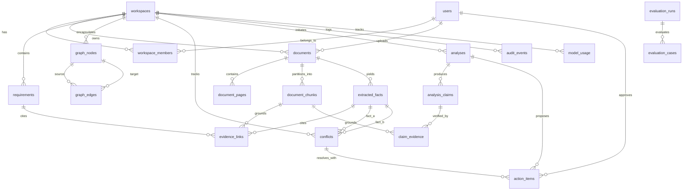

# Pramaan AI — Backend Foundation & Database Layer

Pramaan AI backend built with Python 3.11+, FastAPI, SQLAlchemy 2.x, PostgreSQL 16, pgvector, and Alembic.

---

## 1. Architecture Overview

- `app/main.py`: FastAPI application, CORS, request correlation IDs, structured logging.
- `app/core/config.py`: Pydantic Settings with validated environment variables.
- `app/db/engine.py`: SQLAlchemy synchronous Engine, connection pool, `SessionLocal`, `get_db()` dependency.
- `app/models/`: SQLAlchemy 2.0 mapped models with UUID PKs, timezone-aware timestamps, check/unique constraints.
- `app/db/repositories/`: Reusable, typed repository pattern isolating database queries from HTTP routes.
- `migrations/`: Alembic database migration scripts.

---

## 2. Database Migrations Workflow

Migrations must **always** be executed explicitly via CLI / deployment steps. Application startup never invokes `create_all()` in production.

### CLI Commands

Run from the `backend/` directory with the virtual environment activated:

```bash
# 1. Apply migrations to the latest revision (HEAD)
alembic upgrade head

# 2. Check the current active migration revision
alembic current

# 3. Verify schema drift (checks whether models and DB schema match 100%)
alembic check

# 4. Generate a new revision after updating SQLAlchemy models
alembic revision --autogenerate -m "describe_change"

# 5. Rollback the most recent migration revision
alembic downgrade -1
```

---

## 3. Implemented Database Schema (20 Tables)

### A. Workspace and Identity
1. **`workspaces`**: Tenancy boundary (`id` UUID PK, `name`, `slug` UNIQUE, timestamps).
2. **`users`**: User identities (`id` UUID PK, `auth_subject` UNIQUE, `email`, `display_name`, `status`, timestamps). Passwords are never stored here.
3. **`workspace_members`**: Workspace membership (`id` UUID PK, `workspace_id` FK, `user_id` FK, `role` ENUM check, `uq_workspace_members_user`).

### B. Documents & Lineage
4. **`documents`**: Document metadata (`id` UUID PK, `workspace_id` FK, `storage_key`, `sha256`, `mime_type`, `file_size_bytes`, `page_count`, `processing_status`, `deleted_at`, `uq_documents_workspace_sha256`).
5. **`document_pages`**: Page-level extraction (`id` UUID PK, `document_id` FK, `page_number` >= 1, `extracted_text`, `page_metadata`, `uq_document_pages_page_num`).
6. **`document_chunks`**: Passage chunks with embeddings (`id` UUID PK, `workspace_id` FK, `document_id` FK, `chunk_index` >= 0, `page_start`, `page_end`, `content`, `embedding` VECTOR(384), `embedding_model`, `embedding_version`, `content_hash`, `uq_document_chunks_doc_chunk_idx`).
   - Indexes: HNSW cosine index `ix_document_chunks_embedding_hnsw`, GIN tsvector search index `ix_document_chunks_fts`.

### C. Facts & Requirements
7. **`extracted_facts`**: Extracted domain facts (`id` UUID PK, `workspace_id` FK, `document_id` FK, `page_id` FK, `fact_type`, `raw_value`, `normalized_value` JSONB, `source_quote`, `verification_status`).
8. **`requirements`**: Normalized cross-document requirements (`id` UUID PK, `workspace_id` FK, `title`, `description`, `requirement_type`, `normalized_value` JSONB, `status`).

### D. Evidence-to-Impact Graph
9. **`graph_nodes`**: Graph nodes (`id` UUID PK, `workspace_id` FK, `node_type`, `entity_key`, `display_label`, `metadata`, `uq_graph_nodes_workspace_entity_key`). Node types: `DOCUMENT`, `FACT`, `REQUIREMENT`, `CONFLICT`, `ACTION`.
10. **`graph_edges`**: Directed provenance edges (`id` UUID PK, `workspace_id` FK, `source_node_id` FK, `target_node_id` FK, `relationship_type`, `provenance_type`, `verification_status`, `confidence`, `metadata`, `ck_graph_edges_no_self_loop`, `uq_graph_edges_unique_relation`). Relationship types: `DERIVED_FROM`, `SUPPORTED_BY`, `CONTRADICTS`, `SUPERSEDES`, `AFFECTS`, `ASSIGNED_TO`. Provenance: `DETERMINISTIC`, `MODEL_PROPOSED`, `HUMAN_CONFIRMED`.

### E. Evidence & Analysis
11. **`evidence_links`**: Traced citations (`id` UUID PK, `workspace_id` FK, `chunk_id` FK, `fact_id` FK, `requirement_id` FK, `relationship_type`, `verification_status`, `ck_evidence_links_target_valid`).
12. **`analyses`**: Decision Packet analyses (`id` UUID PK, `workspace_id` FK, `requested_by` FK, `question`, `status`, `result_json`, `model_id`, timestamps).
13. **`analysis_claims`**: Claims generated in analysis (`id` UUID PK, `analysis_id` FK, `claim_text`, `support_status`).
14. **`claim_evidence`**: Chunk citations backing claims (`id` UUID PK, `claim_id` FK, `chunk_id` FK, `evidence_role`, `uq_claim_evidence_unique`).

### F. Governance & Conflicts
15. **`conflicts`**: Conflict pairs (`id` UUID PK, `workspace_id` FK, `fact_a_id` FK, `fact_b_id` FK, `conflict_type`, `severity`, `status`, `resolution_note`, `resolved_by` FK, `ck_conflicts_no_self_pair`, `ck_conflicts_ordered_pair`, `uq_conflicts_workspace_fact_pair`).
16. **`action_items`**: Action proposals with governance (`id` UUID PK, `workspace_id` FK, `related_analysis_id` FK, `related_conflict_id` FK, `description`, `priority`, `status`, `idempotency_key`, `approved_by` FK, `approved_at`, `ck_actions_approved_requires_human`, `ck_actions_rejected_requires_human`, `uq_action_items_workspace_idempotency`).

### G. Audit & Evaluation
17. **`audit_events`**: Immutable audit logs (`id` UUID PK, `workspace_id` FK, `actor_user_id` FK, `event_type`, `entity_type`, `entity_id`, `request_id`, `metadata`).
18. **`model_usage`**: Model telemetry (`id` UUID PK, `workspace_id` FK, `analysis_id` FK, `provider`, `model_id`, `request_id`, `input_tokens`, `output_tokens`, `latency_ms`, `estimated_cost`, `status`).
19. **`evaluation_runs`**: Offline evaluation benchmark runs (`id` UUID PK, `dataset_version`, `evaluator_version`, `status`, `metrics`, timestamps).
20. **`evaluation_cases`**: Individual evaluation case results (`id` UUID PK, `evaluation_run_id` FK, `case_id`, `actual_output`, `expected_output`, `scores`, `status`, `uq_evaluation_cases_run_case`).

---

## 4. Entity Relationship Diagram (ERD)



---

## 5. Repository Layer Inventory

| Repository | Entities Managed | Key Operations |
|---|---|---|
| `WorkspaceRepository` | `Workspace`, `WorkspaceMember` | `create`, `get_by_slug`, `list_all`, `add_member`, `get_members` |
| `UserRepository` | `User` | `create`, `get_by_auth_subject`, `get_by_email`, `list_by_status` |
| `DocumentRepository` | `Document` | `create`, `get_by_sha256`, `list_by_workspace`, `update_status`, `soft_delete` |
| `DocumentPageRepository` | `DocumentPage` | `create`, `get_by_page_number`, `list_by_document` |
| `DocumentChunkRepository` | `DocumentChunk` | `create`, `list_by_document`, `list_by_workspace` |
| `FactRepository` | `ExtractedFact` | `create`, `list_by_document`, `list_by_workspace`, `update_verification` |
| `RequirementRepository` | `Requirement` | `create`, `list_by_workspace`, `update_status` |
| `GraphRepository` | `GraphNode`, `GraphEdge` | `create_node`, `get_node_by_entity_key`, `create_edge`, `get_out_edges`, `get_in_edges` |
| `ConflictRepository` | `Conflict` | `create` (canonical ordered pairs), `get_by_fact_pair`, `resolve`, `dismiss` |
| `ActionRepository` | `ActionItem` | `create`, `get_by_idempotency_key`, `approve` (human required), `reject` |
| `AnalysisRepository` | `Analysis`, `AnalysisClaim`, `ClaimEvidence`, `EvidenceLink` | `create`, `update_status`, `add_claim`, `add_claim_evidence`, `add_evidence_link` |
| `AuditRepository` | `AuditEvent` | `log`, `list_by_workspace`, `list_by_request_id` |
| `ModelUsageRepository` | `ModelUsage` | `record`, `list_by_workspace`, `list_by_analysis`, `get_total_tokens` |
| `EvaluationRepository` | `EvaluationRun`, `EvaluationCase` | `create_run`, `update_run_status`, `add_case`, `get_cases` |

---

## 6. Testing

Run tests against local PostgreSQL with rollback transactions:

```bash
cd backend
.venv/bin/pytest -q
.venv/bin/ruff check app tests
```
